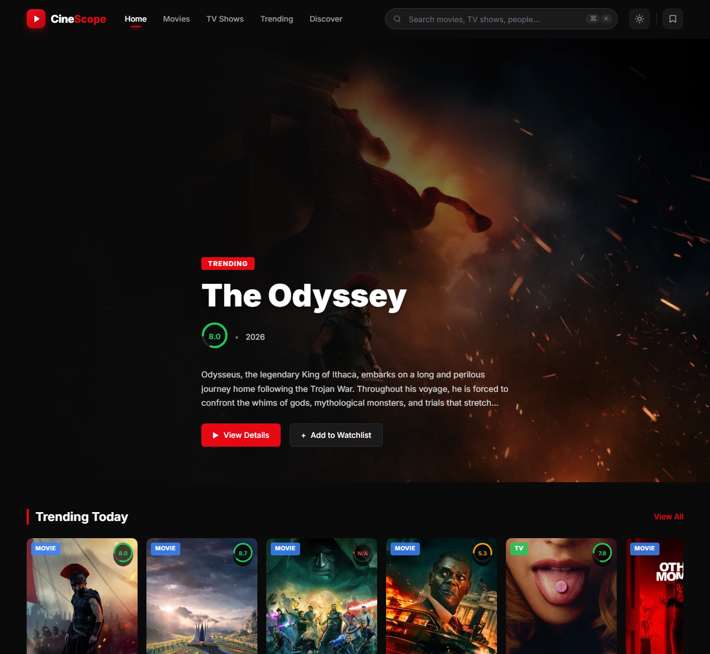

# 🎬 CineScope

[](https://github.com/Armin0001/cinescope/actions/workflows/ci.yml)

A full-featured movie & TV discovery app built with Angular 18 and the [TMDB API](https://www.themoviedb.org/). Browse trending titles, search across movies, shows & people, explore cast & crew, watch trailers, and manage personal watchlists.

**Live demo: [cinescope-lilac.vercel.app](https://cinescope-lilac.vercel.app)**



---

## ✨ Features

- 🔥 **Trending** — today & this week, across movies and TV
- 🔍 **Instant search** — typeahead suggestions with 300ms debounce
- 🎬 **Movie & TV detail pages** — cast, crew, videos, images, reviews, similar titles, watch providers
- 🧑 **Person pages** — biography, filmography
- 🗂️ **Discover** — advanced filters (genre, year, rating, language) + Surprise Me random picker
- ❤️ **Watchlists** — Want to Watch, Watching, Completed, Favorites (stored locally)
- 🌙 **Dark / Light mode** — persisted across sessions
- 📱 **Fully responsive** — mobile, tablet, desktop
- ⚡ **Skeleton loading** — no spinners, smooth perceived performance
- ♾️ **Infinite scroll** — on all browse & discover pages

---

## 🧭 Key decisions

- **Every page is lazy-loaded.** Each route uses `loadComponent` ([`app.routes.ts`](src/app/app.routes.ts)), so the first visit only downloads the shell and the home page (about 117 kB over the wire) and other pages load when you open them.
- **Standalone components and signals instead of NgModules and a state library.** The watchlist and theme are small enough for a signal plus `computed` views in a root service ([`watchlist.service.ts`](src/app/core/services/watchlist.service.ts)), and the templates react to them without manual subscriptions.
- **One service owns every TMDB call.** [`TmdbService`](src/app/core/services/tmdb.service.ts) builds all URLs and query strings in one place: it adds the API key, drops filters you left empty, and picks image sizes. Components never build URLs themselves.
- **Typeahead uses `debounceTime` + `distinctUntilChanged` + `switchMap`.** It waits for a pause in typing, skips repeated queries, and cancels the previous request when a new one starts, so slow responses can't overwrite newer ones.
- **A title lives in one watchlist at a time,** keyed by TMDB id *and* media type, because a movie and a TV show can share an id.
- **Client-only, with the tradeoff stated:** without a backend, the TMDB key ships in the browser bundle. That's acceptable for a read-only, rate-limited key, but a server-side proxy (for example a Vercel function) is the fix if the key ever needs to stay private. Vercel rewrites every path to `index.html` ([`vercel.json`](vercel.json)) so deep links like `/movies/550` work.

---

## 🧪 Tests

25 unit tests with Jasmine and Karma:

```bash
npm test          # watch mode, opens a browser
npm run test:ci   # single run in headless Chrome, as CI does
```

| Spec | Covers |
|---|---|
| [`watchlist.service.spec.ts`](src/app/core/services/watchlist.service.spec.ts) | one list per title, movie vs. TV ids, moves, removals, saving to and restoring from `localStorage`, corrupt saved data |
| [`tmdb.service.spec.ts`](src/app/core/services/tmdb.service.spec.ts) | API key on every request, URL building, safe encoding of search text, empty discover filters dropped, image sizes and the placeholder (with `HttpTestingController`, no network) |
| [`theme.service.spec.ts`](src/app/core/services/theme.service.spec.ts) | default theme, restoring and saving the choice, applying it to the page |
| [`rating-circle.component.spec.ts`](src/app/shared/components/rating-circle/rating-circle.component.spec.ts) | score formatting, colour thresholds, ring fill |
| [`app.component.spec.ts`](src/app/app.component.spec.ts) | the app shell and applying the saved theme at startup |

Writing these turned up a real bug: posters fell back to `assets/placeholder.svg`, but this project's static files live in `public/` and are served from the site root, so on Vercel that path returned the app's `index.html` and every title without artwork showed a broken image. It now points at `placeholder.svg`, and a test pins it.

CI ([`.github/workflows/ci.yml`](.github/workflows/ci.yml)) runs the tests in headless Chrome and a production build on every push and pull request.

---

## 🛠 Tech Stack

| | |
|---|---|
| Framework | [Angular 18](https://angular.dev) (standalone components, signals) |
| Styling | SCSS with CSS custom properties |
| Data | [TMDB API v3](https://developer.themoviedb.org) |
| Scroll | [ngx-infinite-scroll](https://github.com/orizens/ngx-infinite-scroll) |
| Tests | Jasmine, Karma |
| Deployment | [Vercel](https://vercel.com) |

---

## 🚀 Getting Started

### Prerequisites
- Node.js 20+
- A free [TMDB API key](https://www.themoviedb.org/settings/api)

### Install & run

```bash
git clone https://github.com/Armin0001/cinescope.git
cd cinescope
npm install
```

Put your TMDB key in `tmdbApiKey` in [`src/environments/environment.ts`](src/environments/environment.ts) (and [`environment.prod.ts`](src/environments/environment.prod.ts) for production builds), then:

```bash
npm start         # http://localhost:4200
npm run build     # production build in dist/tmdb-app/browser
```

---

## 🗺️ Project structure

```
src/app/
├── core/
│   ├── models/          # TMDB response types
│   └── services/        # TmdbService, WatchlistService, ThemeService (+ specs)
├── features/            # one lazy-loaded page per route: home, movies, tv, search, discover, ...
└── shared/components/   # navbar, footer, media card, rating circle, hero banner, skeletons
```

---

## 🔭 What's next

- Move TMDB calls behind a serverless proxy so the API key stays private.
- Sync watchlists across devices (they live in `localStorage` today).
- Upgrade to a current Angular major and its built-in Vitest runner, since Karma is deprecated.

---

## 📄 License

[MIT](LICENSE). This product uses the TMDB API but is not endorsed or certified by TMDB.
